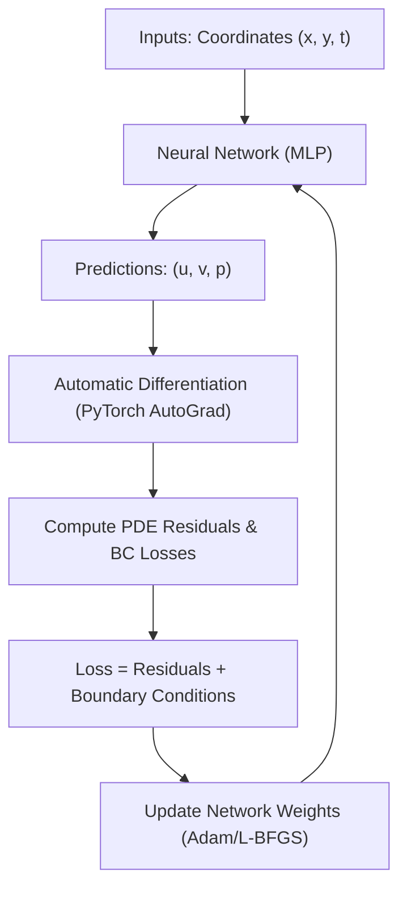

# Physics-Informed Neural Networks and CFD in PhysicsNeMo

Welcome to your guide on **PhysicsNeMo** and **Physics-Informed Neural Networks (PINNs)**! This document is designed for beginners. It explains the core concepts, the physics, the repository examples, and how to run a simulation or extend it to compressible flows.

---

## 1. Introduction to the PhysicsNeMo Framework

**PhysicsNeMo** (formerly known as NVIDIA Modulus) is a deep learning framework designed to build, train, and evaluate AI-driven multi-physics models. It combines standard neural network architectures (like MLPs, CNNs, and GNNs) with physical laws (PDEs) to create fast surrogate models for engineering and science.

The codebase is organized into several key modules:
*   **`physicsnemo.sym`**: The symbolic PDE module. It uses SymPy to define partial differential equations and converts them into PyTorch graphs that evaluate physical residuals using automatic differentiation.
*   **`physicsnemo.models`**: A catalog of pre-built neural network architectures optimized for physics, including standard Multi-Layer Perceptrons (MLPs), Fourier Neural Operators (FNOs), and Graph Neural Networks (GNNs like MeshGraphNet).
*   **`physicsnemo.mesh`**: A module to load, represent, and sample CAD geometries and computational meshes.
*   **`physicsnemo.distributed`**: Infrastructure for training across multiple GPUs.

---

## 2. Comparing Deep Learning Architectures for Physics
Your professor mentioned **PINNs** and asked about how they differ from **GNNs** and **CNNs**. Here is a high-level comparison:

| Architecture | Domain Representation | Physics Incorporation | Data Requirements | Typical Use Cases |
| :--- | :--- | :--- | :--- | :--- |
| **PINN (Physics-Informed Neural Network)** | **Mesh-free / Continuous**<br>(Input: continuous space-time coordinates $x, y, z, t$) | **Implicit**<br>(Trained directly on PDE residuals & boundary conditions) | **Zero data**<br>(Requires only a geometry definition, no pre-run solver files) | Parametric study of simple shapes, solving inverse problems (finding parameters). |
| **GNN (Graph Neural Network)** | **Unstructured Mesh**<br>(Input: node coordinates and mesh connectivity) | **Data-driven**<br>(Learns message passing on the mesh from datasets) | **High data**<br>(Requires pre-computed simulation data from solver outputs) | Complex structures, CAD geometry variations, transient fluid dynamics (e.g., vortex shedding). |
| **CNN (Convolutional Neural Network)** | **Regular/Structured Grid**<br>(Input: 2D/3D pixel/voxel tensor) | **Data-driven** or **Hybrid**<br>(FNOs/PINOs use Fourier transforms / grid derivatives) | **Medium to High data**<br>(Requires datasets on uniform grids) | Global weather forecasting, rectangular Darcy flows, quick grid-based surrogates. |

### Physics-Informed Neural Networks (PINNs)
PINNs represent the physical field (e.g., velocity, pressure, temperature) as a continuous function $f_\theta(\mathbf{x}, t)$, where $\theta$ are the weights of a neural network. 



*   **How it works**:
    1. Pass spatial coordinates $(x, y)$ to an MLP.
    2. The network outputs predicted velocities $(u, v)$ and pressure $p$.
    3. Compute spatial derivatives (like $\frac{\partial u}{\partial x}$, $\frac{\partial^2 u}{\partial y^2}$) using PyTorch's automatic differentiation (`autodiff`).
    4. Plug these derivatives into the Navier-Stokes equations to get the *residual* (how much the predictions violate the laws of physics).
    5. Formulate the loss function as:
       $$\mathcal{L} = \mathcal{L}_{\text{residual}} + \mathcal{L}_{\text{boundary}}$$
    6. Minimize the loss using an optimizer like Adam. Once training is complete, the network is a continuous, differentiable solver for that specific domain.

### Graph Neural Networks (GNNs)
GNNs represent the physical domain as a graph $G = (V, E)$, where $V$ are the mesh vertices (nodes) and $E$ are the connections (edges).
*   **How it works**:
    *   Instead of coordinates, the network takes a mesh.
    *   Features like node type (wall, inlet, outlet) and edge length are passed to a series of *message passing* layers.
    *   The network learns how physical quantities flow from node to node.
    *   It requires thousands of time-step samples from classical solvers (like COMSOL or OpenFOAM) to learn the mapping from $t \to t+1$.

---

## 3. Incompressible Fluid Dynamics (Physics)

Let's break down the equations used in the incompressible flow examples. For an **incompressible** fluid (such as water, or air at low speeds), the density $\rho$ is constant.

### 1. Conservation of Mass (Continuity Equation)
In 2D, this is written as:
$$\frac{\partial u}{\partial x} + \frac{\partial v}{\partial y} = 0$$

*   **Physical meaning**: The velocity field is divergence-free. The rate at which mass enters a tiny control volume must equal the rate at which it leaves. There are no volume changes or accumulation of mass.

### 2. Conservation of Momentum (Navier-Stokes Equations)
In 2D, these are Newton's Second Law ($F = ma$) applied to a fluid element:

$$\underbrace{u \frac{\partial u}{\partial x} + v \frac{\partial u}{\partial y}}_{\text{Convective Acceleration}} + \underbrace{\frac{1}{\rho} \frac{\partial p}{\partial x}}_{\text{Pressure Gradient}} - \underbrace{\nu \left( \frac{\partial^2 u}{\partial x^2} + \frac{\partial^2 u}{\partial y^2} \right)}_{\text{Viscous Diffusion}} = 0$$

$$\underbrace{u \frac{\partial v}{\partial x} + v \frac{\partial v}{\partial y}}_{\text{Convective Acceleration}} + \underbrace{\frac{1}{\rho} \frac{\partial p}{\partial y}}_{\text{Pressure Gradient}} - \underbrace{\nu \left( \frac{\partial^2 v}{\partial x^2} + \frac{\partial^2 v}{\partial y^2} \right)}_{\text{Viscous Diffusion}} = 0$$

*   **Convective Acceleration**: Represents how fluid transport carries momentum. It is non-linear because velocity $u$ advects itself. This term is responsible for turbulence and complexity in fluids.
*   **Pressure Gradient**: Fluid moves from high-pressure zones to low-pressure zones.
*   **Viscous Diffusion**: $\nu$ is the kinematic viscosity ($\nu = \mu / \rho$). This represents internal fluid friction. Viscosity dampens velocity variations and diffuses momentum outward.

---

## 4. Setting Up & Running the Simulation (CFD)

We will use the **Lid-Driven Cavity (LDC)** example. In this problem, fluid is inside a square box where three walls are stationary (no-slip condition: $u=v=0$), and the top wall moves horizontally at a constant speed ($u=1$), shearing the fluid and creating a large vortex inside the box.

### Step 1: Install Dependencies
Since the background sync was terminated to allow you to run it directly, execute the following command in your terminal to set up the `.venv` virtual environment and install PhysicsNeMo:

```powershell
# Run this in the root directory: c:\Users\AdilFarooq\Desktop\Repositories\physicsnemo
uv sync --extra sym --extra mesh-extras
```

### Step 2: Running the Simulation
Activate the virtual environment and run the training script:

```powershell
# 1. Activate the environment
.venv\Scripts\activate

# 2. Navigate to the example directory
cd examples/cfd/ldc_pinns

# 3. Run the training script
python train.py
```

> [!NOTE]
> Training is configured for **10,000 steps** in `train.py`. On a CPU, this can take a while.
> If you want a quick run to verify it works, you can open [train.py](file:///c:/Users/AdilFarooq/Desktop/Repositories/physicsnemo/examples/cfd/ldc_pinns/train.py) and change line 150 from `for i in range(10000):` to `for i in range(1000):` (1000 steps). It saves visualizations in the `./outputs` folder every 1000 steps.

---

## 5. Extending the Framework to Compressible Flows

In **compressible flows** (e.g., high-speed air, aerodynamics, gas turbines), density $\rho$ is not constant; it changes with pressure and temperature. We must introduce **Density ($\rho$)** and **Temperature ($T$)** as dynamic variables and solve for conservation of Mass, Momentum, Energy, and state.

### The Physics of Compressible Flows

1.  **Mass (Continuity)**:
    $$\frac{\partial (\rho u)}{\partial x} + \frac{\partial (\rho v)}{\partial y} = 0$$
    *Density is now inside the derivatives.*

2.  **Momentum**:
    $$\rho \left( u \frac{\partial u}{\partial x} + v \frac{\partial u}{\partial y} \right) + \frac{\partial p}{\partial x} - \mu \left( \frac{\partial^2 u}{\partial x^2} + \frac{\partial^2 u}{\partial y^2} \right) - \frac{\mu}{3} \frac{\partial}{\partial x} \left( \frac{\partial u}{\partial x} + \frac{\partial v}{\partial y} \right) = 0$$
    $$\rho \left( u \frac{\partial v}{\partial x} + v \frac{\partial v}{\partial y} \right) + \frac{\partial p}{\partial y} - \mu \left( \frac{\partial^2 v}{\partial x^2} + \frac{\partial^2 v}{\partial y^2} \right) - \frac{\mu}{3} \frac{\partial}{\partial y} \left( \frac{\partial u}{\partial x} + \frac{\partial v}{\partial y} \right) = 0$$
    *Includes dilatational viscosity term $\frac{\mu}{3} \nabla(\nabla \cdot \mathbf{u})$ representing compressible expansion/contraction.*

3.  **Energy Conservation**:
    $$\rho C_p \left( u \frac{\partial T}{\partial x} + v \frac{\partial T}{\partial y} \right) - \left( u \frac{\partial p}{\partial x} + v \frac{\partial p}{\partial y} \right) - k \left( \frac{\partial^2 T}{\partial x^2} + \frac{\partial^2 T}{\partial y^2} \right) = 0$$
    *Relates thermal transport ($C_p$ specific heat capacity, $k$ thermal conductivity) to convective acceleration and pressure work.*

4.  **Ideal Gas Equation of State**:
    $$p = \rho R T$$
    *Closes the system of equations by coupling pressure, density, and temperature. $R$ is the specific gas constant.*

---

### Implementation Code

Here is how you can write the `CompressibleNavierStokes` PDE class in PhysicsNeMo:

```python
from sympy import Function, Number, Symbol
from physicsnemo.sym.eq.pde import PDE

class CompressibleNavierStokes(PDE):
    """Steady 2D Compressible Navier-Stokes equations."""

    def __init__(self, mu=1.8e-5, Cp=1005.0, k=0.026, R=287.05, dim=2):
        self.dim = dim
        x, y = Symbol("x"), Symbol("y")
        iv = {"x": x, "y": y}
        
        # Define functions representing physical fields
        u = Function("u")(*iv.values())
        v = Function("v")(*iv.values())
        p = Function("p")(*iv.values())
        rho = Function("rho")(*iv.values())
        T = Function("T")(*iv.values())
        
        # Turn constants into SymPy numbers
        mu = Number(mu)
        Cp = Number(Cp)
        k = Number(k)
        R = Number(R)
        
        # Velocity divergence term
        div_u = u.diff(x) + v.diff(y)
        
        self.equations = {
            # 1. Conservation of Mass (Continuity)
            "continuity": (rho * u).diff(x) + (rho * v).diff(y),
            
            # 2. Conservation of X-Momentum
            "momentum_x": (
                rho * (u * u.diff(x) + v * u.diff(y))
                + p.diff(x)
                - mu * (u.diff(x, 2) + u.diff(y, 2))
                - (mu / 3) * div_u.diff(x)
            ),
            
            # 3. Conservation of Y-Momentum
            "momentum_y": (
                rho * (u * v.diff(x) + v * v.diff(y))
                + p.diff(y)
                - mu * (v.diff(x, 2) + v.diff(y, 2))
                - (mu / 3) * div_u.diff(y)
            ),
            
            # 4. Conservation of Energy
            "energy": (
                rho * Cp * (u * T.diff(x) + v * T.diff(y))
                - (u * p.diff(x) + v * p.diff(y))
                - k * (T.diff(x, 2) + T.diff(y, 2))
            ),
            
            # 5. Ideal Gas Law (Equation of State)
            "equation_of_state": p - rho * R * T,
        }
```

### Steps to Run Compressible Simulations
To train a model on these equations, you would modify the training script:
1.  **Network Architecture**: Change the output dimensions of the network. Instead of outputting 3 values (`u, v, p`), output 5 values: `u, v, p, rho, T` (so `out_features=5` in `FullyConnected`).
2.  **Equation Instantiation**: Initialize your new PDE model:
    ```python
    ns = CompressibleNavierStokes()
    phy_inf = PhysicsInformer(
        required_outputs=["continuity", "momentum_x", "momentum_y", "energy", "equation_of_state"],
        equations=ns,
        grad_method="autodiff",
        device=dist.device,
    )
    ```
3.  **Residual Computation**: Pass all 5 predictions to `PhysicsInformer`:
    ```python
    phy_loss_dict = phy_inf.forward({
        "coordinates": coords,
        "u": interior_out[:, 0:1],
        "v": interior_out[:, 1:2],
        "p": interior_out[:, 2:3],
        "rho": interior_out[:, 3:4],
        "T": interior_out[:, 4:5],
    })
    ```
4.  **Loss Formulation**: Sum the squares of all five residuals plus boundary conditions for velocity, pressure, and temperature.
